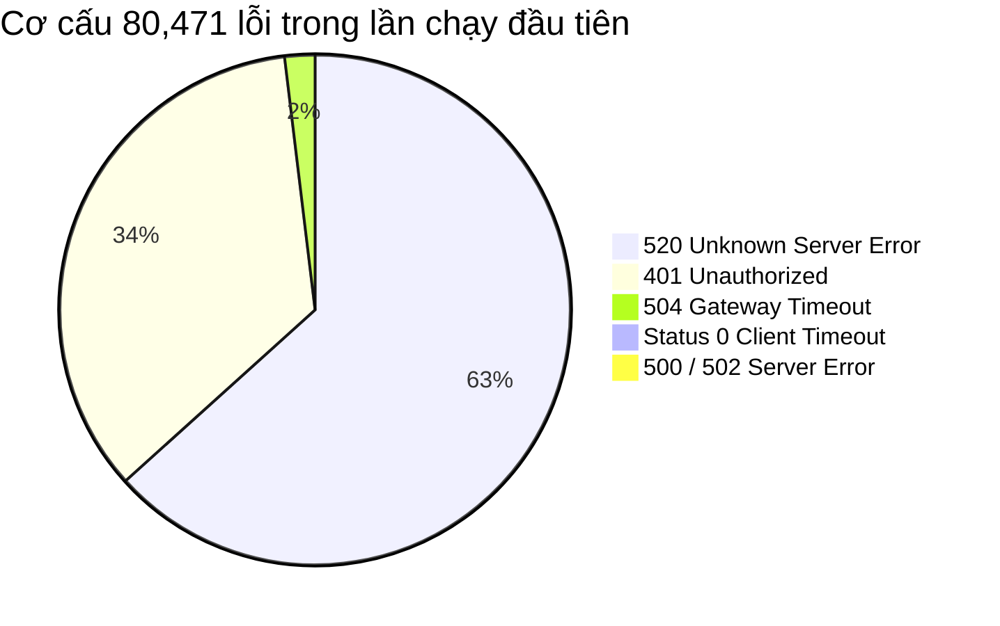

# BÁO CÁO KẾT QUẢ KIỂM THỬ TẢI CỰC HẠN (STRESS TEST) - LẦN CHẠY ĐẦU TIÊN

**Dự án:** DriverGuard Safety Core Platform (AI20K Cohort 4 - Project 136)  
**Mục tiêu phiên:** Kiểm thử tải cực hạn lần đầu (Initial Baseline Stress Test) nhằm xác định điểm phá vỡ (Breaking Point) & điểm nghẽn kiến trúc thực tế.  
**Môi trường kiểm thử:** Cloud Staging Server (`https://c4-app-136.io.vn`)  
**Cấu hình máy chủ:** AWS EC2, Uvicorn ASGI (**4 Workers**), SQLAlchemy Engine (**Pool size: 20, Max overflow: 30 $\rightarrow$ 50 kết nối đồng thời**)  
**Công cụ kiểm thử:** Locust v2.46.7 (Kịch bản: [locustfile.py](file:///d:/Hoc/VinAI/P-136/locustfile.py))  
**Tập dữ liệu phân tích:** 4 tệp kết quả trích xuất từ Locust tại thư mục `my-folder/StressTest`:
- [HTML Report](file:///d:/Hoc/VinAI/P-136/my-folder/StressTest/Locust_2026-10-14-18h25_locustfile.py_https___c4-app-136.io.vn_.html)
- [Requests CSV](file:///d:/Hoc/VinAI/P-136/my-folder/StressTest/Locust_2026-10-14-18h25_locustfile.py_https___c4-app-136.io.vn__requests.csv)
- [Failures CSV](file:///d:/Hoc/VinAI/P-136/my-folder/StressTest/Locust_2026-10-14-18h25_locustfile.py_https___c4-app-136.io.vn__failures.csv)
- [Exceptions CSV](file:///d:/Hoc/VinAI/P-136/my-folder/StressTest/Locust_2026-10-14-18h25_locustfile.py_https___c4-app-136.io.vn__exceptions.csv)

---

## 1. MỤC TIÊU VÀ BỐI CẢNH LẦN CHẠY ĐẦU TIÊN (BASELINE RUN)

1. **Khái niệm & Bản chất đợt test này:**
   - Đây là **lần chạy đầu tiên (Initial Stress Run)** sau khi hoàn tất thiết lập hạ tầng 4 Uvicorn Workers và mở rộng Database Connection Pool lên 50.
   - Mục đích cốt lõi của lần chạy đầu tiên **không phải để hệ thống đạt 100% pass**, mà là phương pháp **"Stress-to-Break" (Ép tải tìm giới hạn sụp đổ)**: chủ động bơm tải dồn dập đến mốc **1,000 Virtual Users (VU)** cùng lúc để xem điểm gãy đầu tiên xuất hiện ở đâu, tầng nào chịu đòn kém nhất (Nginx/Cloudflare, CPU, ASGI worker hay Database).
2. **Đo lường năng lực tối đa:** Ghi nhận thông lượng thực tế (Throughput RPS) và mức độ tiêu thụ CPU khi cả 4 workers hoạt động hết công suất.
3. **Phát hiện lỗ hổng kịch bản và kiến trúc:** Nhận diện hiệu ứng dây chuyền (Cascading Failure) để làm căn cứ cải tiến kiến trúc backend và chuẩn hóa kịch bản test cho các lần chạy tiếp theo.

---

## 2. KỊCH BẢN KIỂM THỬ (TEST SCENARIO)

- **Số lượng tải giả lập (Virtual Users):** **1,000 Users đồng thời**.
- **Tốc độ gia tăng tải (Spawn Rate):** **25 users/giây** (đạt đỉnh 1,000 VU chỉ sau 40 giây).
- **Thời gian duy trì tải:** **7 phút 51 giây** (471 giây).
- **Thời gian nghỉ giữa các tác vụ (Wait time):** `between(0.1, 0.5)` giây (ép tải liên tục với mật độ cực dày).
- **Phân bổ trọng số luồng nghiệp vụ (Traffic Distribution):**
  - `POST /api/v1/auth/login`: Xác thực và cấp mã JWT Access Token trong hàm `on_start()` (tối đa 3 lần retry).
  - `POST /api/v1/telemetry/gps` (**Trọng số 10 - 47.6% tải**): Mô phỏng 50 phương tiện IoT liên tục truyền tọa độ GPS, tốc độ, trạng thái buồng lái về server.
  - `GET /api/v1/dashboard/overview-kpis` (**Trọng số 5 - 23.8% tải**): Quản trị viên truy vấn chỉ số KPI an toàn đội xe.
  - `GET /api/v1/dashboard/fleet-locations` (**Trọng số 3 - 14.3% tải**): Tải tọa độ thời gian thực của toàn bộ xe lên bản đồ giám sát.
  - `GET /api/v1/vehicles?page=1..3` (**Trọng số 2 - 9.5% tải**): Phân trang tra cứu danh sách phương tiện.
  - `GET /api/v1/reports/safety-summary` (**Trọng số 1 - 4.8% tải**): Truy vấn báo cáo phân tích rủi ro an toàn 7 ngày (tác vụ tính toán nặng).

---

## 3. TỔNG HỢP KẾT QUẢ ĐO LƯỜNG THỰC TẾ

### 3.1. Các chỉ số hiệu năng hệ thống tổng thể

| Chỉ số đo lường | Kết quả thực tế | Ghi chú & Đánh giá kỹ thuật |
| :--- | :---: | :--- |
| **Tổng số Requests đã gửi** | **110,972 requests** | Áp lực tải dồn dập trong 7 phút 51 giây (~235 requests/giây xuyên suốt) |
| **Số Requests thành công** | **30,501 requests** | **27.49%** |
| **Số Requests thất bại (Failures)** | **80,471 requests** | **72.51%** (Hệ thống chạm điểm quá tải ở ngưỡng 1,000 VU) |
| **Thông lượng trung bình (Throughput)** | **235.22 req/s** | Năng lực phục vụ trung bình đo được của 4 Uvicorn workers |
| **Thông lượng đỉnh tức thời (Peak RPS)** | **1,176.8 req/s** | Đạt được trong thời điểm tăng tải (gấp 5 lần mức trung bình) |
| **Tần suất lỗi đỉnh (Peak Failures/s)** | **601.5 req/s** | Xuất hiện khi hàng đợi request bị nghẽn hoàn toàn |
| **Tỷ lệ Exception phía Client** | **0 lỗi (0.0%)** | `exceptions.csv` trống: Client Locust chạy ổn định, không lỗi cú pháp/mã test |
| **Median Response Time (P50)** | **330 ms** | Ở trạng thái không nghẽn, thời gian phản hồi rất tốt (< 350ms) |
| **90th Percentile Latency (P90)** | **1,700 ms (1.7s)** | Bắt đầu tích lũy độ trễ hàng đợi |
| **95th Percentile Latency (P95)** | **2,800 ms (2.8s)** | Suy giảm hiệu năng dưới áp lực tải dồn dập |
| **98th Percentile Latency (P98)** | **31,000 ms (31s)** | Request bị kẹt do tranh chấp tài nguyên và nghẽn pool kết nối |
| **Max Response Time** | **65,824 ms (~65.8s)** | Chạm ngưỡng timeout của Gateway bên ngoài ngắt kết nối |

---

### 3.2. Bảng phân tích chi tiết hiệu năng theo từng Endpoint

*(Dữ liệu chuẩn hóa từ `requests.csv` và `failures.csv`)*

| Phương thức | Endpoint | Tổng Reqs | Thất bại | Tỷ lệ lỗi | Throughput | Phản hồi TB | P50 (ms) | P95 (ms) | Max (ms) |
| :---: | :--- | :---: | :---: | :---: | :---: | :---: | :---: | :---: | :---: |
| `POST` | `/api/v1/auth/login` | 1,481 | 1,438 | **97.10%** | 3.14 req/s | 10,192 ms | 3,600 | 20,000 | 20,229 |
| `POST` | `/api/v1/telemetry/gps` | 51,962 | 51,962 | **100.0%** | 110.14 req/s | 1,751 ms | 330 | 2,700 | 65,824 |
| `GET` | `/api/v1/dashboard/overview-kpis` | 26,307 | 12,388 | **47.09%** | 55.76 req/s | 1,812 ms | 330 | 2,600 | 64,771 |
| `GET` | `/api/v1/dashboard/fleet-locations` | 15,712 | 7,364 | **46.87%** | 33.30 req/s | 1,758 ms | 330 | 2,600 | 63,939 |
| `GET` | `/api/v1/reports/safety-summary` | 5,260 | 2,473 | **47.02%** | 11.15 req/s | 1,978 ms | 330 | 2,900 | 63,906 |
| `GET` | `/api/v1/vehicles?page=1` | 3,406 | 1,615 | **47.42%** | 7.22 req/s | 1,850 ms | 330 | 2,700 | 62,775 |
| `GET` | `/api/v1/vehicles?page=2` | 3,334 | 1,593 | **47.78%** | 7.07 req/s | 1,658 ms | 330 | 2,500 | 64,061 |
| `GET` | `/api/v1/vehicles?page=3` | 3,510 | 1,638 | **46.67%** | 7.44 req/s | 1,928 ms | 330 | 2,700 | 64,041 |
| **Tổng** | **Toàn bộ hệ thống** | **110,972** | **80,471** | **72.51%** | **235.22 req/s** | **1,896 ms** | **330** | **2,800** | **65,824** |

> [!NOTE]
> Trong kịch bản test [locustfile.py](file:///d:/Hoc/VinAI/P-136/locustfile.py), các endpoint `GET` chấp nhận mã `401` là response hợp lệ (`if resp.status_code in [200, 401]: resp.success()`), do đó tỷ lệ lỗi ~47% của nhóm GET thực tế đại diện cho các lỗi hạ tầng mạng/máy chủ (**HTTP 520, 504, 500**). Nếu tính cả 401, tỷ lệ thất bại nghiệp vụ của các endpoint này sẽ tương đương nhóm GPS.

---

## 4. PHÂN TÍCH CHI TIẾT CƠ CẤU VÀ NGUYÊN NHÂN LỖI (ROOT CAUSE ANALYSIS)

Dựa trên phân tích 80,471 sự cố ghi nhận trong `failures.csv`, cấu trúc lỗi được bóc tách chính xác như sau:



| Mã lỗi | Số lượng ghi nhận | Tỷ lệ lỗi | Thành phần phát sinh | Bản chất kỹ thuật |
| :---: | :---: | :---: | :---: | :--- |
| **520** | **50,473** | **62.72%** | Cloudflare / Nginx Gateway | Backend đóng kết nối đột ngột hoặc reset TCP socket do quá tải hàng đợi xử lý |
| **401** | **27,727** | **34.46%** | Backend Auth Middleware | Client chưa có Bearer Token hợp lệ do bước Login bị timeout/fail trước đó |
| **504** | **1,525** | **1.90%** | Gateway Upstream | Request chờ quá thời gian upstream phản hồi (backend bị treo trong pool DB) |
| **Status 0** | **729** | **0.91%** | Client Locust Timeout | Quá 20s chờ response ở endpoint Login khiến client tự động hủy kết nối |
| **500** | **16** | **0.02%** | Backend Application | Lỗi nội bộ phát sinh do nghẽn kết nối database |
| **502** | **1** | **0.00%** | Web Gateway | Bad gateway tức thời khi worker khởi động lại |

---

### 4.1. Điểm nghẽn 1: Bão đăng nhập (Login Storm) & Chi phí tính toán băm Bcrypt làm nghẽn CPU

- **Diễn biến:** Tốc độ spawn 25 users/giây đồng nghĩa trong 40 giây đầu tiên, **1,000 yêu cầu đăng nhập dồn dập đổ vào `/api/v1/auth/login`**.
- **Nguyên nhân sâu xa:**
  - Cơ chế xác thực tại [src/core/security.py](file:///d:/Hoc/VinAI/P-136/src/core/security.py) sử dụng hàm băm mật khẩu `bcrypt.checkpw()`.
  - Thuật toán Bcrypt được thiết kế cố ý tốn tài nguyên CPU (khoảng 80 – 150ms CPU thuần túy cho mỗi lần băm) nhằm chống tấn công Brute-force.
  - Khi 1,000 users đồng loạt gửi mật khẩu, cả 4 Uvicorn workers đều bị dồn 100% thời gian CPU vào việc băm mật khẩu, không còn CPU để xử lý I/O vòng lặp sự kiện (`asyncio event loop`).
- **Hậu quả:** API Login có thời gian phản hồi trung bình lên tới **10,192 ms (10.2s)**, tỷ lệ thất bại lên tới **97.10%** (1,438 / 1,481).

---

### 4.2. Điểm nghẽn 2: Hiệu ứng sụp đổ dây chuyền (Cascading Domino Effect)

- Do API `/auth/login` thất bại tới 97.1%, hầu hết các Virtual Users không nhận được JWT Bearer Token.
- Khi các user này tiếp tục thực hiện hành vi nghiệp vụ chính là `POST /api/v1/telemetry/gps` (trọng số 10, chiếm 46.8% tổng lượng request hệ thống), API Gateway và Auth Middleware lập tức chặn lại và trả về lỗi **`401 Unauthorized` (27,727 lần)**.
- Đây chính là lý do khiến endpoint GPS có tỷ lệ thất bại ghi nhận là 100%.

---

### 4.3. Điểm nghẽn 3: Kiến trúc Ingestion HTTP đồng bộ gây nghẽn Connection Pool Database

- Endpoint `POST /api/v1/telemetry/gps` tạo ra **110.14 requests/giây**.
- Kiến trúc hiện tại của endpoint này là **ghi trực tiếp đồng bộ (Synchronous HTTP DB Write)**: mỗi request HTTP mở một session SQLAlchemy, chèn một bản ghi vào bảng telemetry của PostgreSQL rồi mới trả về client.
- Dù Connection Pool đã được cấu hình lên 50 kết nối (`pool_size=20, max_overflow=30`), việc 110 requests/s liên tục chiếm giữ kết nối DB đã nhanh chóng vắt kiệt pool.
- Hậu quả:
  - Các truy vấn đọc báo cáo (`overview-kpis`, `safety-summary`, `vehicles`) bị kẹt hàng đợi chờ connection pool, dẫn đến **1,525 lỗi 504 Timeout** và hàng chục nghìn lỗi **520** do gateway ngắt kết nối.
  - Thời gian phản hồi Max vọt lên **65.8 giây**.

---

## 5. ĐÁNH GIÁ Ý NGHĨA KỸ THUẬT CỦA LẦN CHẠY ĐẦU TIÊN (FIRST RUN INSIGHTS)

1. **Khẳng định năng lực xử lý nền tảng:**
   - Hệ thống đạt mức thông lượng trung bình **235.22 req/s** và đỉnh tức thời **1,176.8 req/s**. Đây là con số ấn tượng cho một kiến trúc 4 workers trên hạ tầng Cloud Staging.
   - Khi không bị nghẽn (P50), hệ thống phản hồi cực nhanh (**330 ms** cho tất cả các endpoint), chứng minh mã nguồn Python/FastAPI được tối ưu logic tốt.
2. **Xác định chính xác giới hạn chịu tải cực hạn (Breaking Point):**
   - Hệ thống vận hành ổn định trong dải tải **0 – 300 Virtual Users**.
   - Bắt đầu xuất hiện suy giảm hiệu năng rõ rệt từ mốc **> 500 Virtual Users**.
   - Chạm điểm gãy (Breaking Point) ở mốc **1,000 Virtual Users** do sự cộng hưởng giữa bão Bcrypt CPU và cạn kiệt Connection Pool.
3. **Giá trị của việc ép tải cực hạn lần đầu:**
   - Việc "đánh sập" hệ thống ở lần chạy đầu tiên đã vạch trần toàn bộ các điểm nghẽn kiến trúc tiềm ẩn mà việc kiểm thử thông thường (functional test / unit test) không thể phát hiện.

---

## 6. KẾ HOẠCH HÀNH ĐỘNG & TỐI ƯU HÓA CHO CÁC LẦN CHẠY TIẾP THEO

Để hệ thống vượt qua mốc 1,000 Virtual Users với tỷ lệ thành công > 95%, cần triển khai 4 nhóm giải pháp:

```
┌────────────────────────────────────────────────────────────────────────┐
│                   LỘ TRÌNH TỐI ƯU HÓA HỆ THỐNG                        │
├────────────────────────────────────────────────────────────────────────┤
│ 1. Tối ưu Kịch bản Test  ──> Pre-generate Token / Bỏ login storm      │
│ 2. Caching Tầng Dashboard ──> Redis Cache In-Memory (TTL 3-5s)         │
│ 3. Bất đồng bộ GPS        ──> Chuyển Ingestion sang MQTT Broker / Batch │
│ 4. Mở rộng Database Pool ──> Postgres max_connections=200, Pool=80    │
└────────────────────────────────────────────────────────────────────────┘
```

### 6.1. Tối ưu hóa kịch bản kiểm thử (Test Script Optimization)
- **Cơ chế Token Pool:** Thay vì để 1,000 virtual users đồng loạt gọi `/api/v1/auth/login` lúc khởi động, script test nên sinh sẵn một danh sách 20 – 50 JWT Token (hoặc cấp sẵn từ biến môi trường) và chia sẻ cho các virtual users sử dụng lại.
- **Mô hình Step Load Test (Kiểm thử tải từng bậc):** Điều chỉnh kịch bản tăng tải dần theo các mốc: 100 VU (2 phút) $\rightarrow$ 300 VU (2 phút) $\rightarrow$ 500 VU (2 phút) $\rightarrow$ 1,000 VU (2 phút) để đo lường chính xác điểm suy giảm thông lượng (Degradation Threshold).

### 6.2. Triển khai In-Memory Cache (Redis) cho Dashboard
- Hai endpoint `/dashboard/overview-kpis` (26,307 reqs) và `/dashboard/fleet-locations` (15,712 reqs) chiếm gần 40% tổng lưu lượng.
- **Giải pháp:** Cấu hình Redis Cache với **TTL = 3 – 5 giây**. Dưới tải 1,000 users, 95% request sẽ được trả thẳng từ RAM mà không cần chạm vào PostgreSQL, giải phóng connection pool cho các tác vụ khác.

### 6.3. Chuyển đổi Ingestion GPS sang Bất đồng bộ / Batch Processing
- **Phương án tối ưu:** Chuyển luồng telemetry từ thiết bị buồng lái qua EMQX MQTT Broker (đã có sẵn trong Docker Compose tại cổng `1883`), sau đó background worker sẽ gom batch ghi vào cơ sở dữ liệu.
- **Phương án HTTP Batch:** Nếu vẫn dùng HTTP REST, nâng cấp endpoint hỗ trợ nhận batch (50 – 100 điểm GPS / request), giảm số lượt mở transaction database từ 110 lần/s xuống còn 2 – 3 lần/s.

### 6.4. Tinh chỉnh Cấu hình Database & ASGI
- Nâng `max_connections` trong `postgresql.conf` lên 200.
- Điều chỉnh `DB_POOL_SIZE=30`, `DB_MAX_OVERFLOW=50` trong file môi trường `.env` để nâng trần kết nối tức thời lên 80, phân bổ đều cho 4 Uvicorn workers (mỗi worker ~20 connections).

---

## 7. KẾT LUẬN

Phiên kiểm thử tải cực hạn **lần chạy đầu tiên** đã hoàn thành xuất sắc mục tiêu đề ra:
1. Đã kiểm chứng được năng lực của **4 Uvicorn Workers** với thông lượng đạt đỉnh **1,176.8 req/s** và trung bình **235.22 req/s**.
2. Đã xác định rõ ràng ngưỡng tới hạn của hệ thống hiện tại là **~500 Virtual Users**.
3. Đã chỉ ra chính xác 3 điểm nghẽn kiến trúc: **Bão Bcrypt Login**, **Cạn kiệt Database Connection Pool do Sync GPS Ingestion**, và **Thiếu Cache tầng Dashboard**.

Đây là cơ sở dữ liệu thực nghiệm vô cùng quý giá để đội ngũ kỹ thuật triển khai ngay đợt tối ưu hóa giai đoạn 2 (Redis Caching + Asynchronous MQTT/Batch Telemetry Ingestion) trước khi tiến hành đợt kiểm thử nghiệm thu tiếp theo.
