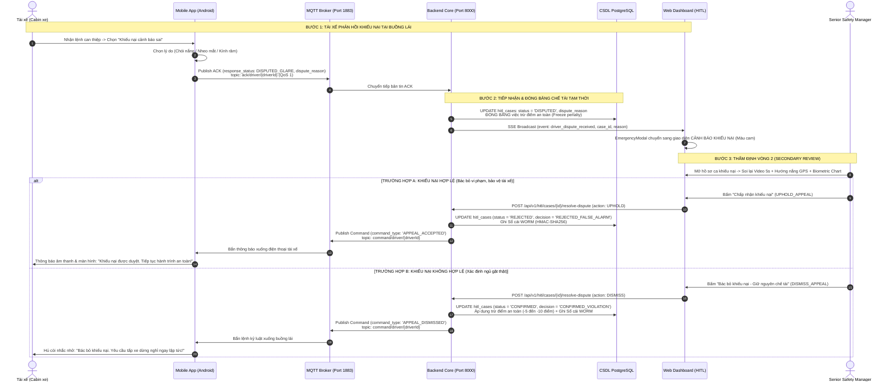

# QUY TRÌNH XỬ LÝ KHIẾU NẠI AN TOÀN (HITL DISPUTE & APPEAL WORKFLOW)
### DRIVERGUARD — NỀN TẢNG GIÁM SÁT AN TOÀN BUỒNG LÁI THÔNG MINH

> **Tài liệu đặc tả kỹ thuật & phân rã tác vụ (Task Breakdown)**  
> **Áp dụng cho:** Phân hệ Can thiệp khẩn cấp buồng lái (Human-in-the-Loop — HITL)  
> **Mục tiêu:** Thay thế cơ chế tự động chấp thuận giả lập (mock ACK) bằng luồng phản hồi 2 chiều thực tế giữa Buồng lái (Android DMS) $\leftrightarrow$ Backend $\leftrightarrow$ Web Dashboard.

---

## I. HIỆN TRẠNG & BẢN CHẤT VẤN ĐỀ HIỆN TẠI

1. **Hiện trạng trên Frontend Web (`EmergencyModal.jsx`):**
   * Sau khi Fleet Manager bấm *"Yêu cầu dừng an toàn"*, hệ thống đang dùng hàm đếm thời gian `setTimeout(..., 1500)` để **tự gọi API `telemetryApi.postDriverAck(...)`** với trạng thái cố định `ACCEPTED_REST`.
   * Giao diện lập tức hiển thị *"Tài xế đã đồng ý dừng nghỉ 30 phút"* ngay cả khi tài xế thực tế chưa bấm xác nhận trên điện thoại trong cabin.

2. **Hiện trạng trên Mobile App & Backend:**
   * **Mobile App Android:** Hộp thoại `DmsCommandHandler` thực tế đã có 2 nút: *"Chấp thuận dừng nghỉ"* (`ACCEPTED_REST`) và *"Khiếu nại cảnh báo sai"* (`DISPUTED_GLARE`), gửi qua MQTT topic `ack/driver/{driver_id}` với QoS 1.
   * **Backend Core:** Hàm `ingest_driver_ack` đã tiếp nhận bản tin MQTT, nhưng mới chỉ ghi nhận text vào trường ghi chú `case.manager_note`, chưa phát sinh sự kiện Server-Sent Events (SSE) để cập nhật giao diện Dashboard theo thời gian thực và chưa có cơ chế thẩm định vòng 2 (Re-adjudication).

---

## II. CHI TIẾT 4 BƯỚC XỬ LÝ KHIẾU NẠI (HITL DISPUTE WORKFLOW)

---

### BƯỚC 1: Tài xế gửi khiếu nại từ buồng lái (Cabin Dispute Submission)
* **Kích hoạt:** Sau khi Fleet Manager phát lệnh *"Yêu cầu dừng xe an toàn"*, app phát giọng nói cảnh báo và bật hộp thoại can thiệp.
* **Hành vi tài xế:** Thay vì bấm chấp thuận dừng xe, tài xế bấm nút **"Khiếu nại cảnh báo sai"**.
* **Thu thập dữ liệu khiếu nại:** 
  - Tài xế chọn nhanh 1 trong các lý do:
    1. `SUNLIGHT_GLARE`: Chói nắng mặt trời trực diện làm nheo mắt.
    2. `GLASSES_REFLECTION`: Kính cận/kính mát phản chiếu bóng sáng.
    3. `SENSOR_MISIDENTIFICATION`: Cúi đầu nhìn gương chiếu hậu/bản đồ chỉ đường.
  - Ứng dụng đóng gói gói tin MQTT gửi lên `ack/driver/{driver_id}` với QoS 1 (lưu SQLite Outbox nếu mất sóng tạm thời).

### BƯỚC 2: Tiếp nhận & Đóng băng chế tài tạm thời (Penalty Freeze)
* **Phía Backend:**
  - Nhận bản tin MQTT ACK $\rightarrow$ cập nhật trạng thái ca trong bảng `hitl_cases` sang `DISPUTED`.
  - **Đóng băng điểm số:** Tuyệt đối không trừ điểm an toàn (`safety_score`) của tài xế tại thời điểm này.
  - Video clip 5s liên quan được gắn cờ niêm phong: `freeze_reason: DRIVER_DISPUTED_SUNLIGHT_GLARE` để ngăn chặn quy trình xóa tự động (TTL retention).
* **Phía Web Dashboard:**
  - Backend bắn sự kiện SSE `driver_dispute_received` tới trình duyệt.
  - Màn hình `EmergencyModal` của Manager lập tức chuyển từ trạng thái quay vòng chờ (Spinner) sang **Thẻ cảnh báo khiếu nại màu cam/vàng**, phát âm báo nhắc nhở Manager ca này tài xế không đồng thuận.

### BƯỚC 3: Thẩm định vòng 2 chuyên sâu (Secondary Re-adjudication)
* Ca vi phạm được đưa vào danh mục riêng: **Hàng đợi Khiếu nại (Disputed Cases Queue)**.
* Senior Safety Manager / Quản lý ca trực mở hồ sơ đối soát lại:
  1. **Đối soát Video 5s:** Quan sát kỹ cơ mặt tài xế (mắt nhắm nghiền thả lỏng cơ mặt hay nheo mắt nhăn trán do ánh sáng mạnh).
  2. **Đối soát Dữ liệu Không gian & Thời gian:**
     - Xem lại tọa độ GPS, thời gian sự cố (ví dụ: 09:30 - 10:30 sáng).
     - Đối chiếu góc di chuyển của phương tiện (Heading/Direction) với hướng chiếu mặt trời thực tế tại thời điểm đó.
  3. **Đối soát Biểu đồ Trắc sinh học:** So sánh độ mở mắt (EAR) và góc đầu (Pitch) có trùng khớp với hành vi nheo mắt phản xạ hay gục đầu ngủ gật.

### BƯỚC 4: Ra phán quyết giải quyết khiếu nại (Final Dispute Resolution)
Manager bấm 1 trong 2 nút phán quyết trên Dashboard:

* **Phương án A — Chấp nhận khiếu nại (Uphold Appeal - Báo sai):**
  - Chuyển trạng thái ca thành `REJECTED_FALSE_ALARM`.
  - Bảo lưu 100% điểm tín nhiệm an toàn cho tài xế.
  - Ghi nhận mã băm WORM xác thực lý do hủy bỏ.
  - Phát bản tin MQTT `APPEAL_ACCEPTED` xuống buồng lái: Điện thoại tài xế tắt toàn bộ cảnh báo, hiển thị lời chúc lái xe an toàn.
  - Tự động đánh dấu đoạn video 5s vào tập dữ liệu **Edge AI Hard Negative Mining** để đội ngũ AI tiếp tục fine-tune mô hình chống chói nắng.

* **Phương án B — Bác bỏ khiếu nại (Dismiss Appeal - Giữ nguyên phạt):**
  - Chuyển trạng thái ca thành `CONFIRMED_VIOLATION`.
  - Áp dụng trừ điểm an toàn và khóa nhận cuốc mới trong 30-60 phút.
  - Ghi nhận phán quyết cuối cùng vào Sổ cái bất biến WORM HMAC-SHA256 phục vụ thanh tra lao động.
  - Bắn bản tin MQTT `APPEAL_DISMISSED` xuống buồng lái kèm giọng nói đanh thép: *"Quản lý an toàn đã bác bỏ khiếu nại sau khi đối soát video. Yêu cầu tài xế chấp hành dừng xe nghỉ ngơi an toàn ngay lập tức!"*

---

## III. CHI TIẾT CÁC CÔNG VIỆC CẦN THỰC HIỆN THEO PHÂN HỆ

---

### 1. PHÂN HỆ MOBILE APP (ANDROID NATIVE DMS)

| STT | Tác vụ kỹ thuật | File mã nguồn cần chỉnh sửa | Chi tiết thực hiện |
| :---: | :--- | :--- | :--- |
| **MOB-1** | **Bổ sung Dialog chọn lý do khiếu nại** | `domain/DmsCommandHandler.java` `ui/DriverFlowActivity.java` | Khi tài xế click *"Khiếu nại cảnh báo sai"*, hiển thị Radio Dialog cho phép chọn lý do: `SUNLIGHT_GLARE`, `GLASSES_REFLECTION`, `SENSOR_MISIDENTIFICATION`. |
| **MOB-2** | **Đóng gói Payload MQTT ACK đầy đủ** | `data/repository/MqttCommandRepository.java` | Đính kèm `response_status: "DISPUTED_GLARE"`, `dispute_reason: <mã lý do>`, `driver_note: <ghi chú>`, `responded_at: <ISO timestamp>`. Đảm bảo đẩy qua SQLite Outbox nếu mất sóng. |
| **MOB-3** | **Trạng thái buồng lái chờ khiếu nại** | `DmsCommandHandler.java` `res/layout/activity_main.xml` | Tắt còi hú cabin sau khi bấm gửi khiếu nại. Hiển thị thanh thông báo màu vàng: *"Đã gửi khiếu nại lên trung tâm điều hành. Vui lòng giữ an toàn..."*. |
| **MOB-4** | **Lắng nghe & Xử lý kết quả giải quyết khiếu nại** | `DmsCommandHandler.java` `data/repository/MqttCommandRepository.java` | Lắng nghe command mới từ topic `command/driver/{driverId}`: • `APPEAL_ACCEPTED`: Hiện Toast/Dialog xanh, TTS: *"Khiếu nại đã được chấp thuận"*, khôi phục màn hình bình thường. • `APPEAL_DISMISSED`: Hiện Alert đỏ, còi nhắc nhở, TTS: *"Khiếu nại bị từ chối, yêu cầu dừng xe!"*. |

---

### 2. PHÂN HỆ BACKEND CORE (FASTAPI + MQTT + CSDL)

| STT | Tác vụ kỹ thuật | File mã nguồn cần chỉnh sửa | Chi tiết thực hiện |
| :---: | :--- | :--- | :--- |
| **BE-1** | **Cập nhật Enum CSDL & Model** | `src/models/hitl.py` `src/schemas/dashboard.py` | Bổ sung giá trị `DISPUTED = "DISPUTED"` vào `HitlStatus`. Thêm trường `dispute_reason: str` và `dispute_resolved_at: datetime` vào bảng `hitl_cases`. Tạo Alembic migration. |
| **BE-2** | **Cập nhật luồng MQTT ACK & Bắn SSE Realtime** | `src/services/telemetry_service.py` `src/services/mqtt_service.py` | Trong `ingest_driver_ack`: • Khi `payload.response_status == "DISPUTED_GLARE"`: Set `case.status = HitlStatus.DISPUTED`, lưu `case.dispute_reason`. • Gọi `await sse_broadcaster.broadcast(event_type="driver_ack_received", data={...})` đẩy tức thời xuống Web. |
| **BE-3** | **Xây dựng API Thẩm định vòng 2 (Resolve Dispute)** | `src/api/hitl.py` `src/schemas/dashboard.py` | Tạo endpoint `POST /api/v1/hitl/cases/{case_id}/resolve-dispute`: • Input: `resolution: "UPHOLD_APPEAL" \| "DISMISS_APPEAL"`, `manager_note: str`. • Xử lý: Đổi status tương ứng, tính lại điểm an toàn của tài xế nếu bác bỏ, ghi Sổ cái WORM với action `DISPUTE_RESOLUTION`. • Gửi lệnh MQTT tương ứng xuống app tài xế qua `mqtt_service.publish_driver_command`. |
| **BE-4** | **Cập nhật API Hàng đợi Queue hỗ trợ lọc khiếu nại** | `src/api/hitl.py` | Cập nhật `GET /api/v1/hitl/queue`: Thêm query param `status=DISPUTED` để hỗ trợ hiển thị danh sách các ca tài xế đang khiếu nại. |

---

### 3. PHÂN HỆ FRONTEND (WEB DASHBOARD REACT)

| STT | Tác vụ kỹ thuật | File mã nguồn cần chỉnh sửa | Chi tiết thực hiện |
| :---: | :--- | :--- | :--- |
| **FE-1** | **Loại bỏ hoàn toàn đoạn mã Mock ACK giả lập** | `web/src/components/hitl/EmergencyModal.jsx` | Xóa bỏ đoạn `setTimeout(..., 1500)` và lời gọi `telemetryApi.postDriverAck(...)` tại dòng 208-218. Modal chỉ giữ trạng thái `setStep('AWAITING_ACK')`. |
| **FE-2** | **Lắng nghe sự kiện SSE `driver_ack_received`** | `web/src/pages/DashboardPage.jsx` `web/src/components/hitl/EmergencyModal.jsx` | Đăng ký lắng nghe SSE: • Nếu nhận `response_status === 'ACCEPTED_REST'`: Chuyển sang `step = 'COMPLETED'`, hiện nhãn xanh thành công. • Nếu nhận `response_status === 'DISPUTED_GLARE'`: Chuyển sang `step = 'DISPUTED'`, hiện giao diện khiếu nại màu cam. • Timeout 45s: Nếu tài xế không bấm, hiện cảnh báo *"Tài xế chưa phản hồi buồng lái"* kèm nút gọi điện khẩn cấp. |
| **FE-3** | **Thiết kế giao diện Xử lý khiếu nại trên Modal** | `web/src/components/hitl/EmergencyModal.jsx` | Khi ở trạng thái `DISPUTED`: • Hiển thị lý do khiếu nại và thời gian gửi. • Cung cấp nút: **"Chấp nhận khiếu nại (Hủy phạt)"** và **"Bác bỏ khiếu nại (Giữ nguyên phạt)"**. • Khi bấm, gọi API `hitlApi.resolveDispute(caseId, payload)`. |
| **FE-4** | **Bổ sung Tab "Khiếu nại" trên HITL Queue** | `web/src/components/hitl/HitlQueuePanel.jsx` | Thêm tab lọc `DISPUTED` (màu cam) bên cạnh `PENDING` và `RESOLVED` để Manager có thể tra cứu và xử lý các ca khiếu nại tồn đọng. |

---

## IV. MA TRẬN ĐỐI SOÁT KIỂM THỬ E2E (ACCEPTANCE CRITERIA)

| Mã kiểm thử | Kịch bản kiểm thử | Hành vi kỳ vọng (Expected Result) | Trạng thái đạt |
| :---: | :--- | :--- | :---: |
| **E2E-DISP-01** | Manager phát lệnh can thiệp dừng xe | Frontend chuyển sang `AWAITING_ACK`, **không tự động nhảy sang thành công sau 1.5s**. | ⬜ Cần kiểm chứng |
| **E2E-DISP-02** | Tài xế bấm "Chấp thuận dừng nghỉ" trên mobile | Frontend nhận SSE trong $< 500\text{ms}$, hiển thị màu xanh: Tài xế đã đồng ý dừng xe. | ⬜ Cần kiểm chứng |
| **E2E-DISP-03** | Tài xế bấm "Khiếu nại - Chói nắng" trên mobile | Frontend nhận SSE trong $< 500\text{ms}$, chuyển sang Thẻ màu cam: Tài xế đang khiếu nại (Chói nắng). Điểm an toàn tài xế được giữ nguyên. | ⬜ Cần kiểm chứng |
| **E2E-DISP-04** | Manager bấm "Chấp nhận khiếu nại" | Ca chuyển `REJECTED`, điểm an toàn bảo toàn 100%, mobile nhận thông báo hủy lệnh can thiệp. | ⬜ Cần kiểm chứng |
| **E2E-DISP-05** | Manager bấm "Bác bỏ khiếu nại" | Ca chuyển `CONFIRMED`, trừ điểm an toàn tài xế, mobile hú còi yêu cầu dừng xe bắt buộc. | ⬜ Cần kiểm chứng |
| **E2E-DISP-06** | Ghi sổ cái bất biến WORM | Mọi thao tác chấp nhận hoặc bác bỏ khiếu nại đều sinh mã băm SHA-256 + HMAC lưu vào `SafetyAuditLedger`. | ⬜ Cần kiểm chứng |

---

*Tài liệu được khởi tạo và lưu trữ tại:* `d:\Hoc\VinAI\P-136\my-folder\QUY_TRINH_XU_LY_KHIEU_NAI_HITL.md`
